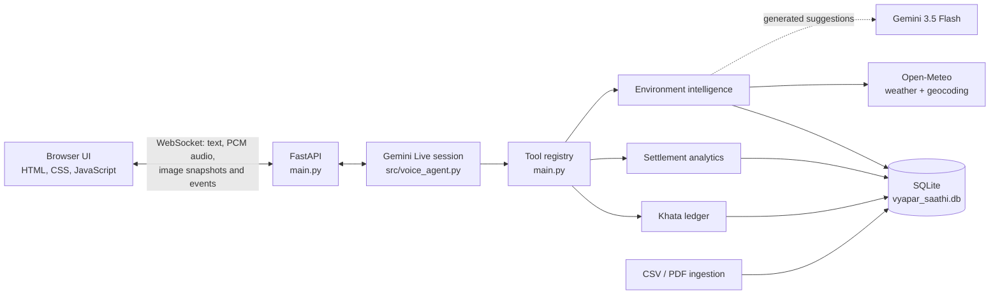

# Merchant AI — Vyapar Saathi

Vyapar Saathi is a voice-first business assistant prototype for a small merchant. It connects a browser conversation to Gemini Live and gives the assistant a small set of tools for checking a customer khata, summarizing settlement data, and returning weather plus clearly qualified local retail suggestions.

## Architecture



### Request flow

1. The browser loads the page at `/` and static files from `/static`.
2. **Connect assistant** opens `/ws`. Text is sent as JSON; microphone audio is sent as 16 kHz PCM; optional camera or screen sharing sends JPEG snapshots.
3. FastAPI starts a Gemini Live session. It streams audio, transcripts, and tool events back to the browser.
4. Gemini can call the registered tools:
   - **Khata:** log, check, or update customer credit. Due and overdue accounts are returned as data; the app does not send reminders.
   - **Settlement analysis:** run a summary, daily totals, instrument comparison, or fees-and-taxes analysis.
   - **Local context:** fetch current weather and use Gemini 3.5 Flash for general suggestions. Results are cached in memory and SQLite for up to four hours.
5. SQLAlchemy stores settlement reports, khata entries, and environment cache records in the project-root `vyapar_saathi.db` database.

At startup, the app initializes the database, seeds missing demo khata rows, and starts the environment cache refresh task.

## Key features

- Browser chat using text or microphone audio, with streamed voice responses.
- Optional camera and screen sharing for visual context.
- Khata ledger actions: `LOG`, `CHECK`, and `UPDATE`, including due-date information.
- Settlement CSV/PDF ingestion with duplicate transaction keys skipped.
- Four predefined settlement analyses: `summary`, `daily_totals`, `by_instrument`, and `fees_and_taxes`.
- Current weather from Open-Meteo and Gemini 3.5 Flash-generated retail suggestions, cached for four hours.
- Structured application and database logging through Logfire.

## Run locally

### Requirements

- Python 3.13 or newer.
- [`uv`](https://docs.astral.sh/uv/) for dependency and environment management.
- A Gemini API key.
- A modern browser. Microphone and camera access require localhost or HTTPS and browser permission.

### Install and configure

From the repository root:

```powershell
uv sync
```

Create a `.env` file in the repository root:

```dotenv
GEMINI_API_KEY=your_gemini_api_key
GEMINI_LIVE_MODEL=gemini-3.8-live
GEMINI_INTELLIGENCE_MODEL=gemini-3.5-flash
```

Keep real credentials private; do not commit `.env`.

### Load settlement reports

The app creates the database tables and seeds demo khata data at startup. To load the bundled settlement CSV files before starting the app:

```powershell
uv run python -m src.data_ingestion
```

The ingestion utility also supports individual CSV and PDF inputs through `DataIngestion.ingest_to_sql(file_path)`. Inputs must match the settlement schema defined in `src/models.py`.

### Start the app

```powershell
uv run uvicorn main:app --host 127.0.0.1 --port 8000
```

Open [http://127.0.0.1:8000](http://127.0.0.1:8000). Select **Connect assistant** to open a session. Text chat works after connecting; use **Start microphone** for voice. Camera and screen sharing are optional.

To run the regression tests:

```powershell
uv run python -m unittest discover -s tests -v
```

## MVP scope

The MVP demonstrates a single merchant’s core assistant workflow:

1. Connect in the browser and ask a business question by voice or text.
2. Check or update sample customer credit in the khata ledger.
3. Ask for supported settlement totals and comparisons after importing report data.
4. Request current weather and cautious, general stocking suggestions for the merchant’s location.

### Current boundaries

- The app uses one configured demo merchant profile and has no authentication or merchant onboarding.
- Settlement analysis is intentionally limited to the four predefined operations; it does not run arbitrary user-supplied code.
- Open-Meteo supplies weather. Gemini 3.5 Flash suggestions do not use live search, so mandi prices, civic alerts, disruptions, and events are **not independently verified**.
- Khata due notifications are returned in the conversation; no SMS, payment links, or reminders are sent.
- Camera and screen input provide visual context only; they do not enable a separate OCR or document-ingestion workflow.
- Demo loan-limit data is illustrative and is not an eligibility result.
- This is a local prototype, not a production-ready multi-merchant or payment-processing system.

## Repository layout

```text
main.py                              FastAPI app, WebSocket, tool registry
src/voice_agent.py                   Gemini Live session and event streaming
src/prompts.py                       Assistant behavior and tool instructions
src/db.py                            SQLite engine and schema initialization
src/models.py                        Khata, environment-cache, settlement models
src/demo_data.py                     Demo merchant profile and sample khata rows
src/data_ingestion.py                CSV/PDF settlement ingestion
src/tools/execute_data_analysis.py   Predefined settlement analyses
src/tools/khata_ledger.py            Customer credit ledger
src/tools/get_shop_environment_intelligence.py
                                     Weather lookup, Gemini suggestions, cache
src/frontend/                        Browser UI, WebSocket client, media handling
data/                                Bundled settlement CSV reports
tests/                               Backend regression tests
```
